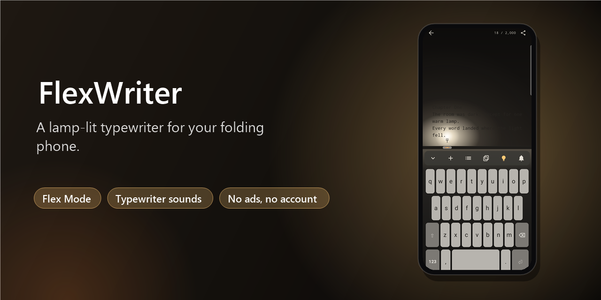
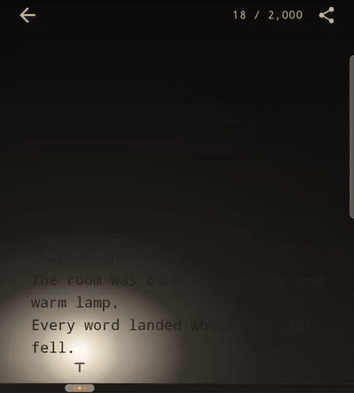
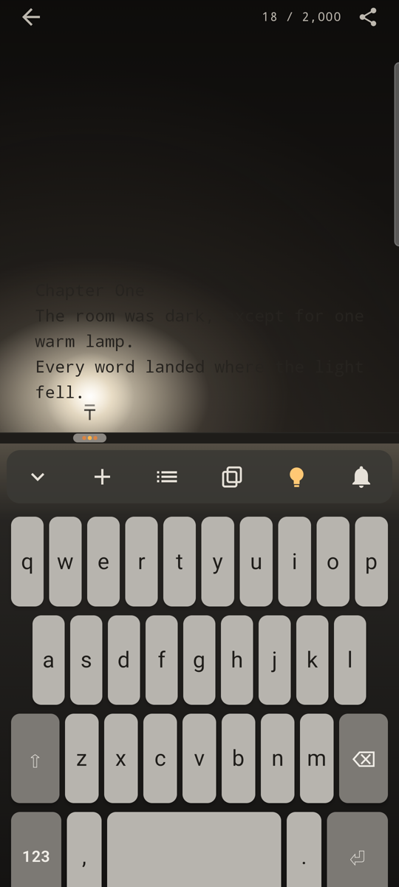

<p align="center">
  
</p>

<h1 align="center">FlexWriter</h1>

<p align="center">
  <b>Half-fold your phone like a tiny laptop. The page glows on top, a typewriter sits below, and the rest of the world goes dark.</b>
</p>

<p align="center">
  <a href="../../releases/latest"></a>
  
  
  
</p>

---

<p align="center">
  
  &nbsp;&nbsp;
  
</p>

## ✍️ Why FlexWriter is different

Most writing apps are text boxes full of buttons, notifications and autocorrect. FlexWriter is a **typewriter**:

- 🪔 **One warm lamp, one line.** The room is dark. A soft desk-lamp glow sits where your letters land, and older lines fade into the shadows, so all you see is the next sentence.
- 📐 **Made for Flex Mode.** Half-fold your Galaxy Z Flip and the page snaps exactly to the top half, with the keyboard on the bottom half, split right at the hinge. Open it flat and it still works.
- ⌨️ **A keyboard that feels like keys.** Its own typewriter keyboard, with a strike sound, a carriage-return *ding*, haptic taps, a carriage that slides along the rail, and paper that rolls up a line at a time.
- ➡️ **Forward only.** No cursor to fiddle with, no autocorrect second-guessing you. Write now, edit later. That's how first drafts get finished.
- 🎯 **A daily goal.** A quiet word counter works toward 2,000 words in the corner.
- 🔒 **Zero permissions.** No internet, no account, no ads, no tracking. Your pages are saved on your phone and nowhere else.

## 🧰 Everything in the toolbar

| | |
|---|---|
| ➕ **New page** | Start a fresh sheet. The old one is saved automatically. |
| 📄 **Pages** | Flip back through everything you've written. |
| 📋 **Copy** | Copy the whole page to paste anywhere. |
| 💡 **Lamp** | Switch between the dark, lamp-lit room and a softly lit sheet of paper. |
| 🔔 **Sound** | Typewriter sounds on or off. |
| ⤴️ **Share** | Send your page to notes, email or any app. |

It also keeps your screen awake while you write, and saves as you type.

---

## 🚀 Get started

1. **Download** `FlexWriter-<version>.apk` from [**Releases**](../../releases/latest) and install it. Allow *Install unknown apps* if asked.
2. Open **FlexWriter**, half-fold your phone, and start typing.

It's built for flip phones (tested on the **Samsung Galaxy Z Flip 5**). On any other Android phone it simply works flat, with the page on top and the keys below.

## 🛠️ Build it yourself

You need JDK 17 and the Android SDK (platform 35).

```bash
./gradlew assembleDebug
# → app/build/outputs/apk/debug/app-debug.apk
```

## 🌟 More from me

- **[FoldGlass](https://github.com/jaspreet9kaur/foldglass):** open your foldable through frosted glass.
- **[FlipDrop](https://github.com/jaspreet9kaur/flipdrop):** flick a photo up and watch it land on your PC.

<p align="center"><b>If FlexWriter helped you write something, leave a ⭐. It keeps the lamp on!</b></p>

---

MIT © jaspreet9kaur
